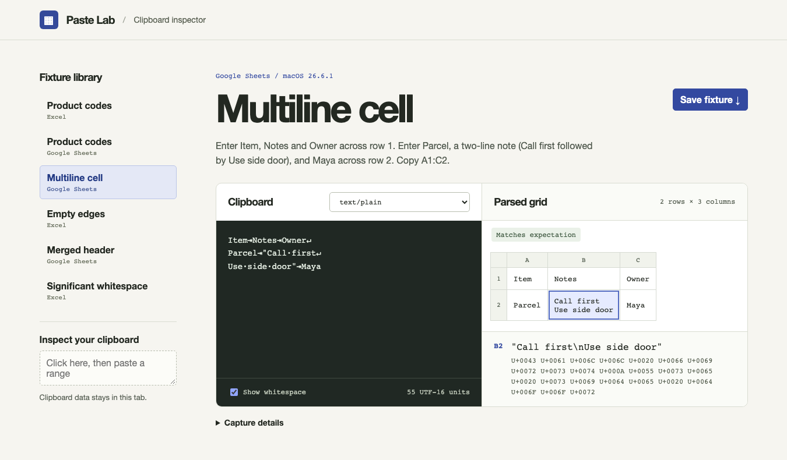

# Paste Lab

An in-browser clipboard inspector for people building spreadsheets, grids and rich-text editors. Pick a real Excel or Google Sheets fixture, inspect its clipboard formats, and click a parsed cell to see its exact string and Unicode code points. Pasted data stays in your browser, including on the hosted demo.

[**Try the live demo →**](https://ejlu.github.io/paste-lab/)



## Run locally

Use Node.js 22.12+ or a current LTS release.

```sh
npm ci
npm run dev
```

Open the local address printed by Vite. Choose **Product codes** and switch between the Excel and Google Sheets examples. Both cells display `00123`. The Sheets compact-table payload also contains the number `123` and the custom format `00000`.

## Capture a regression

1. Copy a range, focus **Inspect your clipboard**, and paste. The app reads the string formats exposed by that paste event. Reloading clears your live capture.
2. Choose a format. Plain text and HTML produce a grid. Other string formats have a raw view. Enable **Show whitespace** to see spaces (·), nonbreaking spaces (⍽), tabs (⇥), CR (␍), and LF (↵).
3. Select **Save fixture**, name the capture, and fill in its source labels. Enter expected grids independently or choose **Use current parser output** and review the result.
4. Download the JSON, place it in `fixtures/`, and run `npm test`. The test runner discovers it automatically. The fixture library includes it the next time the app builds.

For a format that fails to parse, use an expectation such as `{"error":"no-table"}`. The runner checks the stable parser error code and continues to test the other formats.

The grid shows whether each parsed format matches its saved expectation. Use the arrow keys to move between cells. **My latest paste** restores your capture after exploring the library.

The download preserves the original captured strings, including line endings. Files are listed by type, with no binary content collected. Pasted data stays in memory. Review payloads before publishing them since spreadsheet HTML and custom formats can include local paths, formulas and document identifiers.

## The six fixtures

| Fixture | What to inspect |
| --- | --- |
| [Excel product codes](fixtures/excel-product-codes.json) | The formatted number and text ID display alike. The Excel stylesheet contains the five-digit format. |
| [Sheets product codes](fixtures/sheets-product-codes.json) | The same two display strings appear in TSV. Inspect the compact-table format to see the underlying number. |
| [Sheets multiline cell](fixtures/sheets-multiline-cell.json) | A quoted LF in TSV and a `br` in HTML both leave Maya at C2. |
| [Excel empty edges](fixtures/excel-empty-edges.json) | A 3 × 4 range includes a blank middle row and three trailing empty cells. |
| [Sheets merged header](fixtures/sheets-merged-header.json) | Compare the empty B1 field in TSV with the two-column HTML span anchored at A1. |
| [Excel significant whitespace](fixtures/excel-significant-whitespace.json) | The third cell ends with U+0020 in plain text and U+00A0 inside an Excel spacerun in HTML. |

Each JSON includes the recreation recipe, source, captured formats and hand-authored expectations for each grid parser. The examples use invented data. Excel 16.115.2 captures came from the macOS native pasteboard's text and HTML representations. The two local file URL prefixes in each Excel HTML sample were redacted. Sheets captures came through a Chrome 158 paste event on the same Mac. The public fixtures retain Sheets' text, HTML and compact-table JSON and list the two omitted private clipboard types.

## Plug in your parser

`parseFormat(mimeType, rawString)` in [src/parser.ts](src/parser.ts) returns `{ rows, merges }`. Both the UI and the tests call it. Cell values are strings, including empty strings. A covered merge position is `null`. A merge records its zero-based `row` and `column`, plus its `width` and `height`. Ragged rows retain their lengths.

The TSV reader handles tabs, quoted fields, doubled quotes and CR/LF/CRLF. A quote at the start of a field opens a quoted field. Malformed quotes produce an error and preserve the raw input for inspection. A final record separator closes the final row. The HTML reader uses parse5, reads the first table, decodes entities and maps `br` to LF. It preserves source text whitespace and does not apply spreadsheet CSS or infer numeric types. Zero or invalid spans default to one. Grid previews are bounded at 20,000 positions and one million UTF-16 units per format. Larger raw captures can still be inspected in excerpt and exported with a limit-error expectation.

```sh
npm test
npm run build
```

To exercise the regression suite, replace the TSV parser temporarily with a split on newlines and tabs. The multiline fixture will fail because the second line of B2 becomes a new row. Restore the reference parser to get back to green.

MIT licensed.

For the browser checks, run `npx playwright install chromium` followed by `npm run test:browser`. They exercise a live page, fixture downloads and the mobile layout.

## Product IDs and quantities

Open **Product codes → Google Sheets** in the fixture library and scroll to **Inventory import preview**. Row 2 displays `00123` in both columns. With A mapped to Product ID and B to Quantity, the importer emits `{"productId":"00123","quantity":123}`. Map B to both fields to see the same cell imported two ways. Map A to Quantity to see a text-only quantity sent for review.

[compareClipboardFormats](src/importer.ts) compares plain text, HTML table text and typed values by cell position. The prototype understands the dense text-and-number layout observed in the Sheets compact-table capture. This is an undocumented format. Unsupported layouts and missing metadata leave the stored value unavailable. The helper returns each representation separately and identifies display disagreements or a difference between display and storage. Merged ranges and mismatched dimensions are left for review.

The example importer preserves the exact displayed product ID and requires a nonnegative safe integer from a numeric source for quantity. A numeric-looking string alone requires review. The preview maps one data row at a time and treats the first row of a multirow paste as column names.
